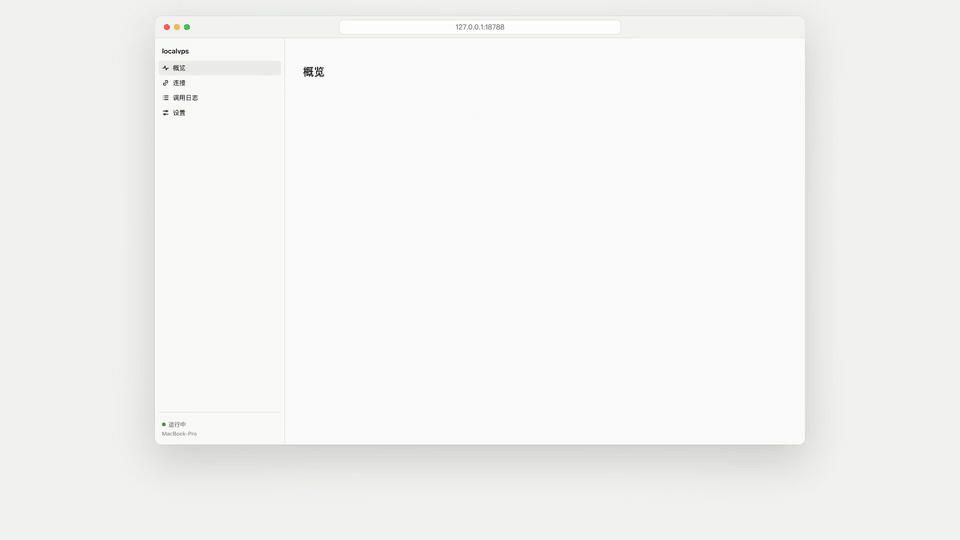
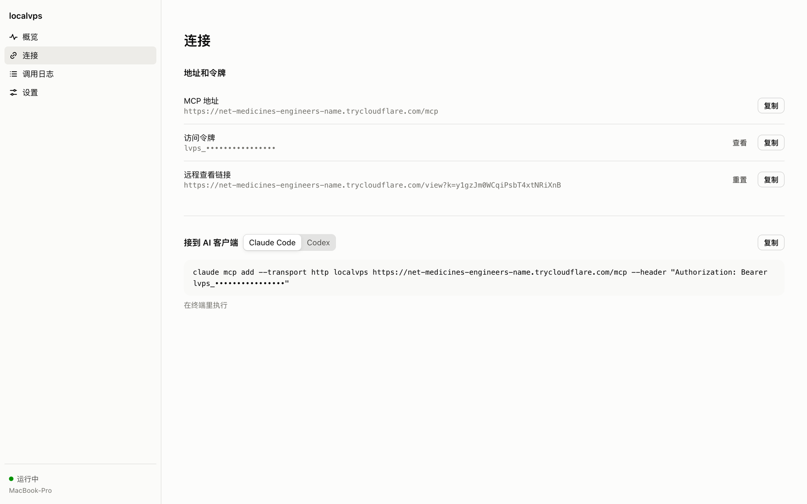
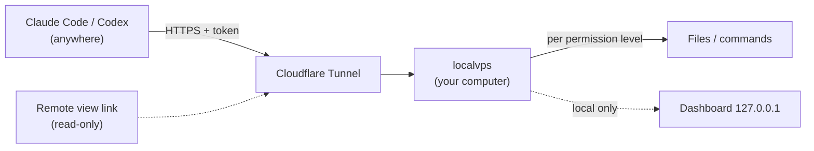
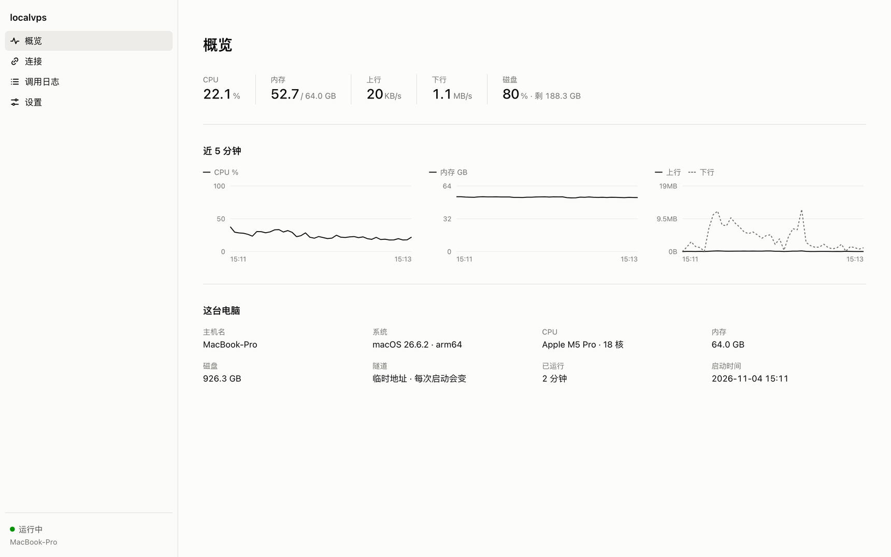
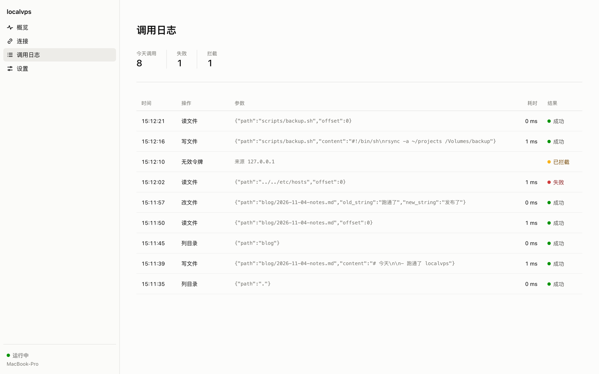
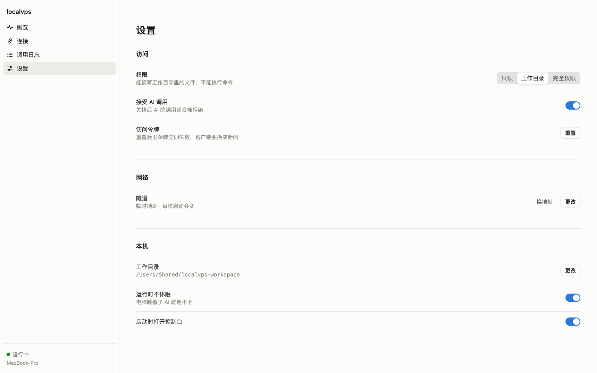

<div align="center">


# localvps

### Turn your computer into a server for AI agents

Run one program, get a public URL and a token.<br>
Claude Code and Codex can then read, write and run commands on this machine — from wherever they run.

[简体中文](README.md) · **English**

[](https://github.com/hengfengliya/localvps/stargazers)
[](https://github.com/hengfengliya/localvps/releases/latest)
[](https://github.com/hengfengliya/localvps/releases)
[](LICENSE)


[![LINUX DO](https://img.shields.io/badge/LINUX-DO-FFB003.svg?logo=data:image/svg%2bxml;base64,DQo8c3ZnIHhtbG5zPSJodHRwOi8vd3d3LnczLm9yZy8yMDAwL3N2ZyIgd2lkdGg9IjEwMCIgaGVpZ2h0PSIxMDAiPjxwYXRoIGQ9Ik00Ni44Mi0uMDU1aDYuMjVxMjMuOTY5IDIuMDYyIDM4IDIxLjQyNmM1LjI1OCA3LjY3NiA4LjIxNSAxNi4xNTYgOC44NzUgMjUuNDV2Ni4yNXEtMi4wNjQgMjMuOTY4LTIxLjQzIDM4LTExLjUxMiA3Ljg4NS0yNS40NDUgOC44NzRoLTYuMjVxLTIzLjk3LTIuMDY0LTM4LjAwNC0yMS40M1EuOTcxIDY3LjA1Ni0uMDU0IDUzLjE4di02LjQ3M0MxLjM2MiAzMC43ODEgOC41MDMgMTguMTQ4IDIxLjM3IDguODE3IDI5LjA0NyAzLjU2MiAzNy41MjcuNjA0IDQ2LjgyMS0uMDU2IiBzdHlsZT0ic3Ryb2tlOm5vbmU7ZmlsbC1ydWxlOmV2ZW5vZGQ7ZmlsbDojZWNlY2VjO2ZpbGwtb3BhY2l0eToxIi8+PHBhdGggZD0iTTQ3LjI2NiAyLjk1N3EyMi41My0uNjUgMzcuNzc3IDE1LjczOGE0OS43IDQ5LjcgMCAwIDEgNi44NjcgMTAuMTU3cS00MS45NjQuMjIyLTgzLjkzIDAgOS43NS0xOC42MTYgMzAuMDI0LTI0LjM4N2E2MSA2MSAwIDAgMSA5LjI2Mi0xLjUwOCIgc3R5bGU9InN0cm9rZTpub25lO2ZpbGwtcnVsZTpldmVub2RkO2ZpbGw6IzE5MTkxOTtmaWxsLW9wYWNpdHk6MSIvPjxwYXRoIGQ9Ik03Ljk4IDcwLjkyNmMyNy45NzctLjAzNSA1NS45NTQgMCA4My45My4xMTNRODMuNDI2IDg3LjQ3MyA2Ni4xMyA5NC4wODZxLTE4LjgxIDYuNTQ0LTM2LjgzMi0xLjg5OC0xNC4yMDMtNy4wOS0yMS4zMTctMjEuMjYyIiBzdHlsZT0ic3Ryb2tlOm5vbmU7ZmlsbC1ydWxlOmV2ZW5vZGQ7ZmlsbDojZjlhZjAwO2ZpbGwtb3BhY2l0eToxIi8+PC9zdmc+)](https://linux.do)

<a href="https://github.com/hengfengliya/localvps/releases/download/v0.1.0/localvps-intro.mp4"></a>

<sub>Click for the 43-second intro video (with sound)</sub>

</div>

## Install in one line

**macOS**

```bash
curl -fsSL https://raw.githubusercontent.com/hengfengliya/localvps/main/install.sh | sh
```

**Windows**: download [localvps-windows-x64.exe](https://github.com/hengfengliya/localvps/releases/latest/download/localvps-windows-x64.exe) and double-click it.

The dashboard opens in your browser, with the connect command one click away. No sign-up, no public IP, no port forwarding, no domain.

> The dashboard UI is in Simplified Chinese for now; an English UI is on the roadmap.

## Why

Your computer already has everything: your code, your toolchains, your logged-in CLIs, local databases, a GPU. But the AI often runs somewhere else — in the cloud, on another machine, in a session you drive from your phone.

Renting a VPS costs money every month, and you have to set up your environment from scratch. Rolling your own tunnel plus an MCP server means writing auth, permissions and logging yourself.

localvps packs all of that into one file: **run it, and your computer is the VPS.**

## What people use it for

- Let Claude Code or Codex running in the cloud or on another machine edit your local projects and read your local files
- Give the AI things only your computer has: a configured dev environment, logged-in CLIs, services on your LAN, a GPU
- Turn a spare computer into a shared workstation for several AI sessions, and watch what each one does in the dashboard
- Check on your home machine from anywhere with the read-only remote view link

## Features

- **One file, just run it**: standalone builds for macOS (Apple silicon, Intel) and Windows — no Node needed
- **Built-in tunnel**: Cloudflare tunnel with zero configuration by default; bring your own domain for a fixed URL
- **Standard MCP**: Streamable HTTP with a bearer token — works with Claude Code, Codex and any MCP client that supports custom headers
- **Three permission levels**: read-only, working-directory read/write, full access — switch with one click, applies to the next call
- **Every call logged**: tool, arguments, duration, success or failure; wrong-token attempts are logged with the source IP
- **A cloud-console-style dashboard**: CPU, memory, network, disk, with 5-minute charts
- **Remote view**: a read-only link to watch this computer from another device; a leaked link only lets someone look
- **One-click controls**: pause AI calls, reset the token, get a new tunnel URL
- **Stays awake**: prevents sleep while running, and stops doing so on exit

## Getting started

**1. Run it** with the one-line install above, or download and run. The dashboard opens at `http://127.0.0.1:18788`.

**2. Connect your AI client** — copy from the dashboard's Connect page.

Claude Code:

```bash
claude mcp add --transport http localvps https://xxxx.trycloudflare.com/mcp --header "Authorization: Bearer lvps_xxxx"
```

Codex, append to `~/.codex/config.toml`:

```toml
[mcp_servers.localvps]
url = "https://xxxx.trycloudflare.com/mcp"
http_headers = { Authorization = "Bearer lvps_xxxx" }
```

**3. Just ask**: in Claude Code, say "use localvps to look at ~/projects on my computer and fix the typos in the README".

<p align="center"></p>

## How it works



localvps runs an MCP server locally. cloudflared opens an outbound connection from your computer to Cloudflare, and public requests come back along it — so no public IP and no router port forwarding.

## Compared with the alternatives

| | localvps | Rent a cloud VPS | Tunnel + DIY MCP server | Local MCP (stdio) |
|---|---|---|---|---|
| Cost | Free | Monthly | Free to paid | Free |
| Uses your computer's existing setup | Yes | No, set up again | Yes | Yes |
| Usable by AI on other machines | Yes | Yes | Yes | No, local only |
| No public IP or open ports | Yes | n/a | Depends | n/a |
| Getting started | Run one file | Set up server and env | Write a server, add auth | Edit client config |
| Permission levels | Three, one click | DIY | DIY | Depends |
| Call log and dashboard | Built in | DIY | DIY | Mostly none |

## Dashboard

<p align="center"></p>

**Call log**: what the AI called, with what, how long it took, whether it worked; wrong-token attempts are marked as blocked, with the source IP.

<p align="center"></p>

**Settings**: permissions, pause, token, tunnel, working directory, keep-awake — all take effect immediately.

<p align="center"></p>

## Permission levels

| Level | What the AI can do |
|---|---|
| Read-only | Read files in the working directory |
| Working directory (default) | Read and write files in the working directory; no commands, can't leave the folder |
| Full | Read and write any file, run any command (your login shell on macOS, PowerShell on Windows) |

Symlinks pointing outside the working directory are blocked too. Switching to full access asks for confirmation.

## Watch this computer from another device

The Connect page has a **remote view link**. Open it on another computer or your phone to see the overview, monitoring, call log and the current MCP URL — handy because the free tunnel gets a new URL on every restart.

Remote view is read-only: permissions, token and tunnel can only be changed on the machine itself, and the token is never shown. The link uses its own key, separate from the MCP token; if it leaks, hit "Reset" on the Connect page and the old link stops working immediately.

## Tunnels

| Tunnel | What you need | URL |
|---|---|---|
| Quick (default) | Nothing | Changes on every start |
| Fixed domain | A Cloudflare account and a domain on Cloudflare | Stable |
| None | Nothing | Local machine or LAN only — pairs well with Tailscale |

For a fixed domain, open Settings → Tunnel → Change and paste your Cloudflare tunnel token and domain; the dialog walks you through getting them.

## Security

- The MCP endpoint requires the token; wrong tokens get 401 and are logged. Reset the token with one click
- The dashboard listens on `127.0.0.1` only, checks the Host header against DNS rebinding, and requires a custom header for every change, so other web pages can't click for you
- There is no settings endpoint on the public URL; remote view never sees the token or keys
- Turn off "Accept AI calls" and every call is refused immediately

**Full access means handing the whole computer to whoever holds the token.** Only give it to AI clients you trust, never commit it to git, never paste it into a chat. Found a security issue? Please report it privately via a [Security Advisory](https://github.com/hengfengliya/localvps/security/advisories/new).

## FAQ

**Stuck on "connecting", and after 45 seconds it says it can't reach Cloudflare**

cloudflared needs outbound access to Cloudflare on port 7844. Proxies like Clash or Surge in TUN mode route that connection through a proxy node, and most nodes block it. Add this rule at the top of your proxy rules and restart the proxy core:

```yaml
- DOMAIN-SUFFIX,argotunnel.com,DIRECT
```

**macOS says the developer can't be verified**

The one-line install avoids this. For a manual download: System Settings → Privacy & Security → Open Anyway.

**Windows SmartScreen pops up**

Click "More info" → "Run anyway".

**Where does cloudflared come from, and what if the download fails**

On first run it is downloaded from Cloudflare's official GitHub Releases into `~/.localvps/bin/`; an existing cloudflared install is used if present. If GitHub can't be reached, the dashboard shows a red notice and keeps retrying every minute while everything else keeps running. You can also download it manually as the notice says, or point `LOCALVPS_CLOUDFLARED_URL` at a mirror.

**The program is gone and the dashboard says "已断开" (disconnected)**

Check `~/.localvps/error.log` (on Windows `C:\Users\<you>\.localvps\error.log`) for the reason.

**Does it work with Claude on the web or mobile?**

Their custom connectors require OAuth, which isn't supported yet — it's on the roadmap.

## Configuration

Everything you change in the dashboard is saved to `~/.localvps/.env`, which you can also edit directly. To override temporarily, use environment variables prefixed with `LOCALVPS_` (e.g. `LOCALVPS_PORT=19000`).

| Key | Default | Meaning |
|---|---|---|
| `ACCESS_TOKEN` | generated | MCP access token |
| `VIEW_KEY` | generated | Key for the remote view link |
| `PERMISSION` | `workspace` | `readonly` / `workspace` / `full` |
| `WORKDIR` | `~/localvps-workspace` | Working directory |
| `TUNNEL` | `cf-quick` | `cf-quick` / `cloudflare` / `none` |
| `CF_TUNNEL_TOKEN`, `PUBLIC_URL` | | For a fixed domain |
| `PORT` | `18787` | MCP server port |
| `PANEL_PORT` | `18788` | Dashboard port |
| `HOST` | `127.0.0.1` | Set to `0.0.0.0` to expose MCP on your LAN |
| `KEEP_AWAKE` | `true` | Prevent sleep while running |
| `OPEN_PANEL` | `true` | Open the dashboard on start |
| `NAME` | hostname | Name shown in the dashboard and remote view |

The call log is also written to `~/.localvps/audit.log`. To use your own cloudflared, set `LOCALVPS_CLOUDFLARED_PATH`.

## Roadmap

- [x] Standalone builds for macOS and Windows
- [x] Cloudflare quick tunnel and fixed domain
- [x] Dashboard, call log, remote view
- [ ] `npx localvps`
- [ ] Start at login
- [ ] Standalone Linux build
- [ ] English dashboard UI
- [ ] OAuth, for Claude on the web and mobile
- [ ] Computer-use tools: screenshots, mouse and keyboard
- [ ] One dashboard for several computers

Want one of these? Say so or upvote in [Issues](https://github.com/hengfengliya/localvps/issues) — priorities follow demand.

## Contributing

Issues and PRs welcome. Local development needs Node.js 20+:

```bash
git clone https://github.com/hengfengliya/localvps.git
cd localvps
npm install
npm run dev          # build and start
npm run build:bin    # build standalone binaries for all three platforms into release/ (needs Bun)
```

The intro video source lives in `video/` (Remotion, with an originally synthesized soundtrack); `./video/render.sh` renders it in one command.

The codebase is small: `src/server.ts` is the MCP server and remote view, `src/tools.ts` the tools and permissions, `src/tunnel.ts` manages cloudflared, `src/panel.*` is the dashboard.

## Star history

<a href="https://star-history.com/#hengfengliya/localvps&Date">
  
</a>

## Acknowledgements

[Model Context Protocol](https://modelcontextprotocol.io) · [Cloudflare Tunnel](https://developers.cloudflare.com/cloudflare-one/connections/connect-networks/) · [systeminformation](https://github.com/sebhildebrandt/systeminformation) · [Bun](https://bun.sh) · UI built on the [Beayy](https://github.com/hengfengliya/beayy) design system

## License

[MIT](LICENSE)
