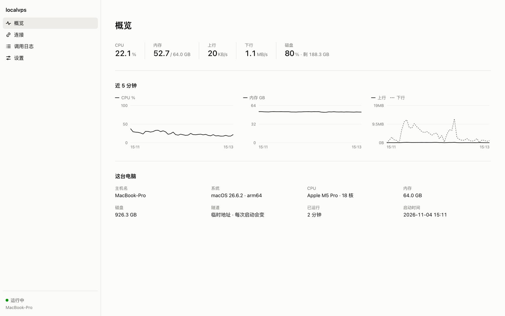
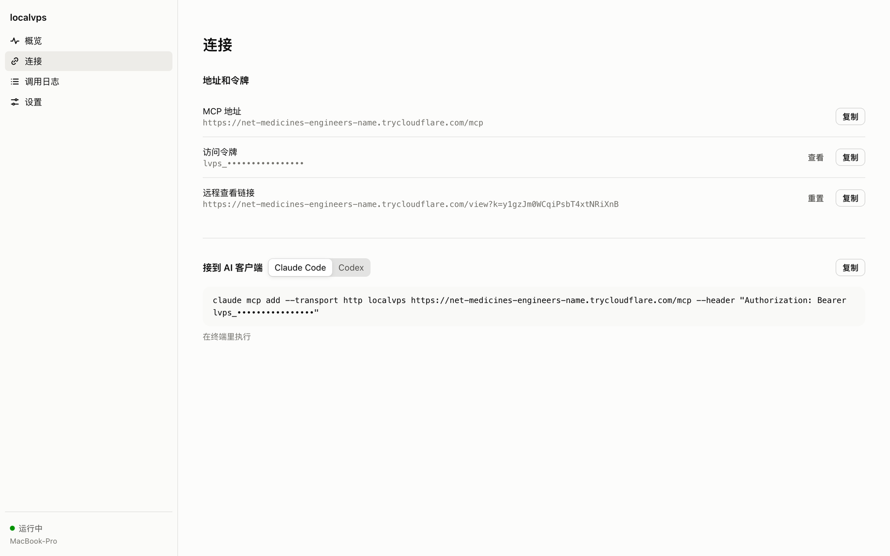
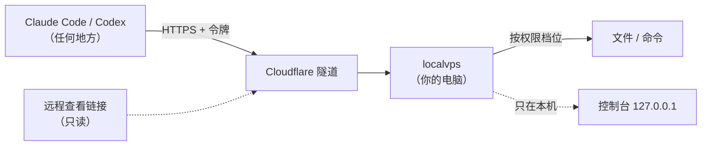
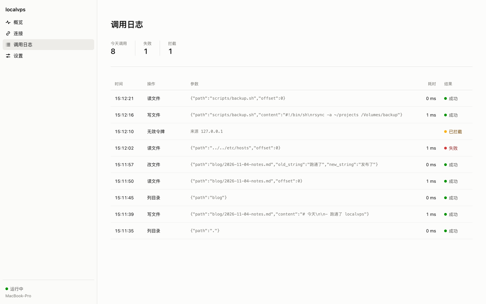
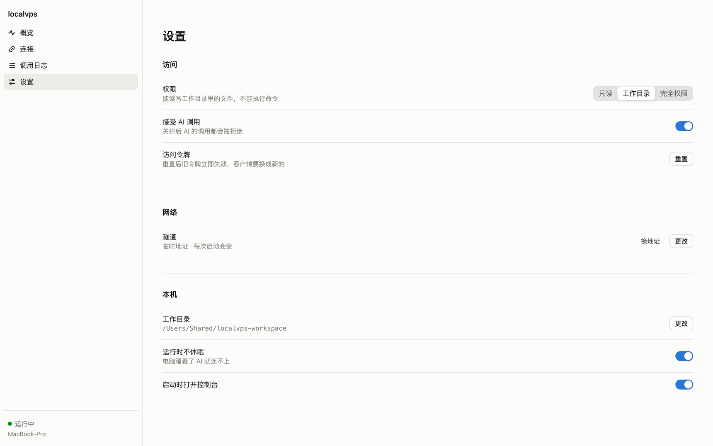

<div align="center">


# localvps

### 把你的电脑变成一台给 AI 用的服务器

运行一个程序，拿到一个公网地址和一个令牌。<br>
Claude Code、Codex 不管在哪儿跑，都能远程在这台电脑上读写文件、执行命令。

**简体中文** · [English](README.en.md)

[](https://github.com/hengfengliya/localvps/stargazers)
[](https://github.com/hengfengliya/localvps/releases/latest)
[](https://github.com/hengfengliya/localvps/releases)
[](LICENSE)




</div>

## 一行安装

**macOS**

```bash
curl -fsSL https://raw.githubusercontent.com/hengfengliya/localvps/main/install.sh | sh
```

**Windows**：下载 [localvps-windows-x64.exe](https://github.com/hengfengliya/localvps/releases/latest/download/localvps-windows-x64.exe)，双击运行。

运行后浏览器自动打开控制台，接入命令在「连接」页一键复制。不用注册，不用公网 IP，不用开端口，不用域名。

## 为什么

你的电脑上已经有你要的一切：代码、装好的工具链、登录好的命令行、本地数据库、显卡。可 AI 常常不在这台电脑上跑——在云端，在另一台机器，在你用手机遥控的会话里。

租一台 VPS 要按月付钱，还得把环境从头装一遍；自己搭内网穿透再写一个 MCP 服务，鉴权、权限、日志都得自己补。

localvps 把这些打成一个文件：**运行它，你的电脑就是那台 VPS。**

## 能拿它做什么

- 云端或另一台电脑上的 Claude Code、Codex，直接改你本机的项目、读你本机的资料
- 让 AI 用只有你电脑上才有的东西：配好的开发环境、登录好的 CLI、内网里的服务、GPU
- 把一台闲着的电脑当成几个 AI 会话共用的工作机，在控制台里看它们都干了什么
- 出门在外，用远程查看链接看家里那台电脑的状态和 AI 的每一次操作

## 特性

- **一个文件，运行即用**：macOS（Apple 芯片、Intel）和 Windows 单文件版，不用装 Node
- **自带隧道**：内置 Cloudflare 隧道，默认什么都不用填；想要固定地址，填上自己的域名
- **标准 MCP**：Streamable HTTP 加 Bearer 令牌，Claude Code、Codex 和任何支持自定义请求头的 MCP 客户端都能接
- **三档权限**：只读、工作目录读写、完全权限，控制台点一下就换，下一次调用就生效
- **每次调用都记着**：工具、参数、耗时、成功失败，错误令牌的来访也记下来源 IP
- **像云服务器后台的控制台**：CPU、内存、网速、磁盘和近 5 分钟曲线
- **远程查看**：一条只读链接，在别的设备上看这台电脑，泄露了也只能看
- **一键开关**：暂停接受调用、重置令牌、换隧道地址，都在控制台里
- **不让电脑睡着**：运行期间防休眠，退出时一起停

## 用起来

**1. 运行**：用上面的一行安装，或者下载后直接运行。浏览器会打开 `http://127.0.0.1:18788` 的控制台。

**2. 接上 AI 客户端**：在控制台「连接」页复制。

Claude Code：

```bash
claude mcp add --transport http localvps https://xxxx.trycloudflare.com/mcp --header "Authorization: Bearer lvps_xxxx"
```

Codex，追加到 `~/.codex/config.toml`：

```toml
[mcp_servers.localvps]
url = "https://xxxx.trycloudflare.com/mcp"
http_headers = { Authorization = "Bearer lvps_xxxx" }
```

**3. 说人话**：在 Claude Code 里说「用 localvps 看看我电脑上的 ~/projects，把 README 里的错别字改掉」。

<p align="center"></p>

## 它是怎么工作的



localvps 在本机起一个 MCP 服务，cloudflared 从你的电脑主动连到 Cloudflare，公网请求再沿这条连接回来——所以不需要公网 IP，也不用在路由器上开端口。

## 和其他做法比

| | localvps | 租一台云服务器 | 内网穿透 + 自己搭 MCP | 本机 MCP（stdio） |
|---|---|---|---|---|
| 费用 | 免费 | 按月付 | 免费到付费 | 免费 |
| 用的是你电脑现成的环境 | 是 | 否，要重装 | 是 | 是 |
| AI 在别的机器上也能用 | 是 | 是 | 是 | 否，只能本机 |
| 不要公网 IP、不开端口 | 是 | 不涉及 | 看方案 | 不涉及 |
| 上手 | 运行一个文件 | 配服务器和环境 | 自己写服务、配鉴权 | 改客户端配置 |
| 权限档位 | 三档，点一下切换 | 自己配 | 自己写 | 看实现 |
| 调用日志和控制台 | 有 | 自己搭 | 自己写 | 多数没有 |

## 控制台

<p align="center"></p>

**调用日志**：AI 调了什么、传了什么、花了多久、成功还是失败；用错令牌来敲门的标成「已拦截」，带来源 IP。

<p align="center"></p>

**设置**：权限、暂停、令牌、隧道、工作目录、防休眠，改完立即生效。

<p align="center"></p>

## 三档权限

| 档位 | AI 能做什么 |
|---|---|
| 只读 | 读工作目录里的文件 |
| 工作目录（默认） | 读写工作目录里的文件，不能执行命令，出不了这个文件夹 |
| 完全权限 | 读写任意文件、执行任意命令（macOS 用你的登录 shell，Windows 用 PowerShell） |

符号链接想跳出工作目录也会被拦下。切到完全权限前会再确认一次。

## 在别的设备上看这台电脑

「连接」页有一条**远程查看链接**。在别的电脑或手机上打开，能看概览、监控、调用日志和最新的接入地址——临时隧道每次重启换地址，对方打开链接就知道新地址。

远程只能看：权限、令牌、隧道这些设置只能在这台电脑本机改，页面上也不显示令牌。查看链接用单独的密钥，和 MCP 令牌无关；外泄了在「连接」页点「重置」，旧链接立刻失效。

## 隧道

| 隧道 | 要准备什么 | 地址 |
|---|---|---|
| 临时地址（默认） | 什么都不用 | 每次启动会变 |
| 固定域名 | Cloudflare 账号和一个托管在 Cloudflare 的域名 | 不变 |
| 不用隧道 | 什么都不用 | 只在本机或局域网，适合配合 Tailscale |

固定域名在「设置 → 隧道 → 更改」里填 Cloudflare 隧道令牌和域名，弹层里有获取步骤。

## 安全

- MCP 接口要令牌，错误令牌一律 401 并记日志；令牌在控制台一键重置
- 控制台只听 `127.0.0.1`，校验 Host 头防 DNS 重绑定，每个写操作要求自定义请求头，别的网页替你点不了
- 公网上没有任何设置接口；远程查看拿不到令牌和密钥
- 「接受 AI 调用」一关，所有调用立即拒绝

**完全权限等于把整台电脑交给拿着令牌的人。** 令牌只给你信任的 AI 客户端，别提交进 git，别贴进聊天。发现安全问题请私下发 [Security Advisory](https://github.com/hengfengliya/localvps/security/advisories/new)。

## 常见问题

**一直「隧道连接中」，45 秒后提示连不上 Cloudflare**

cloudflared 要出站访问 Cloudflare 的 7844 端口。开着 Clash、Surge 这类代理的 TUN（增强）模式时，这条连接会被送进代理节点，多数节点不放行。在代理规则最前面加一条，再重启代理内核：

```yaml
- DOMAIN-SUFFIX,argotunnel.com,DIRECT
```

**macOS 提示「无法验证开发者」**

用一行安装就不会出现。手动下载的话：系统设置 → 隐私与安全性 → 仍要打开。

**Windows 弹出 SmartScreen**

点「更多信息」→「仍要运行」。

**cloudflared 从哪来**

首次运行从 Cloudflare 官方 GitHub Releases 下载到 `~/.localvps/bin/`。已经装了 cloudflared 就直接用。

**能接 Claude 网页版、手机版吗**

它们的自定义连接器要 OAuth 登录，还不支持，在路线图里。

## 配置

控制台改的设置都存在 `~/.localvps/.env`，也可以直接编辑。临时覆盖用环境变量，名字前加 `LOCALVPS_`（如 `LOCALVPS_PORT=19000`）。

| 键 | 默认 | 说明 |
|---|---|---|
| `ACCESS_TOKEN` | 自动生成 | MCP 访问令牌 |
| `VIEW_KEY` | 自动生成 | 远程查看链接的密钥 |
| `PERMISSION` | `workspace` | `readonly` / `workspace` / `full` |
| `WORKDIR` | `~/localvps-workspace` | 工作目录 |
| `TUNNEL` | `cf-quick` | `cf-quick` / `cloudflare` / `none` |
| `CF_TUNNEL_TOKEN`、`PUBLIC_URL` | | 固定域名时填 |
| `PORT` | `18787` | MCP 服务端口 |
| `PANEL_PORT` | `18788` | 控制台端口 |
| `HOST` | `127.0.0.1` | 改成 `0.0.0.0` 让局域网直接访问 MCP |
| `KEEP_AWAKE` | `true` | 运行期间不休眠 |
| `OPEN_PANEL` | `true` | 启动时打开控制台 |
| `NAME` | 主机名 | 控制台和远程查看里显示的名字 |

调用日志同时写在 `~/.localvps/audit.log`。自备 cloudflared 用环境变量 `LOCALVPS_CLOUDFLARED_PATH` 指定。

## 路线图

- [x] macOS、Windows 单文件版
- [x] Cloudflare 临时隧道和固定域名
- [x] 控制台、调用日志、远程查看
- [ ] `npx localvps`
- [ ] 开机自启
- [ ] Linux 单文件版
- [ ] 控制台英文界面
- [ ] OAuth 登录，接 Claude 网页版和手机版
- [ ] 截屏、鼠标键盘这类电脑操作工具
- [ ] 一个控制台管多台电脑

想要哪个，去 [Issues](https://github.com/hengfengliya/localvps/issues) 说一声或点个赞，排序按呼声来。

## 参与

欢迎 Issue 和 PR。本地开发需要 Node.js 20 以上：

```bash
git clone https://github.com/hengfengliya/localvps.git
cd localvps
npm install
npm run dev          # 编译并启动
npm run build:bin    # 用 Bun 编出三个平台的单文件版到 release/
```

代码不多：`src/server.ts` 是 MCP 服务和远程查看，`src/tools.ts` 是工具和权限，`src/tunnel.ts` 管 cloudflared，`src/panel.*` 是控制台。

## Star 趋势

<a href="https://star-history.com/#hengfengliya/localvps&Date">
  
</a>

## 致谢

[Model Context Protocol](https://modelcontextprotocol.io) · [Cloudflare Tunnel](https://developers.cloudflare.com/cloudflare-one/connections/connect-networks/) · [systeminformation](https://github.com/sebhildebrandt/systeminformation) · [Bun](https://bun.sh) · 界面用 [Beayy](https://github.com/hengfengliya/beayy) 的设计系统

## 许可

[MIT](LICENSE)
